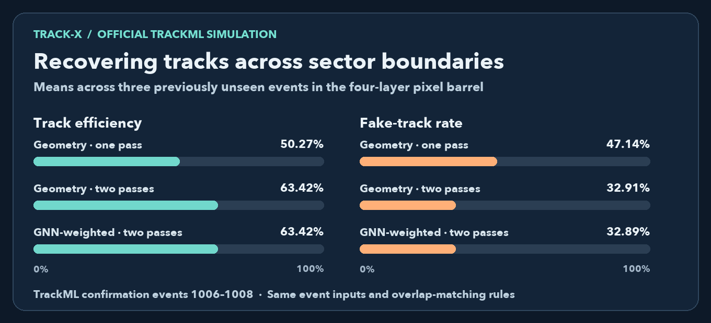

# TRACK-X

**Physics-constrained charged-particle track reconstruction on an Apple M1.**

[](LICENSE) [](pyproject.toml)

TRACK-X links detector hits into trajectories using sparse candidate graphs, compact graph neural networks and geometric constraints. The project includes an offline synthetic benchmark, a held-out evaluation on official TrackML simulated events and an interactive detector lab.

[Research paper](reports/TRACK_X.md) · [Reproducibility guide](reports/phase2/REPRODUCIBILITY.md) · [Architecture](docs/ARCHITECTURE.md) · [Benchmark data](reports/phase2/CONFIRMATION.md)

## Pixel seed replacement on twelve new simulated events

The Omega study improved the official full-event TrackML score on every event in its frozen confirmation cohort. Mean score rose from 0.227243 to 0.228094, and mixed-particle paths fell from 37.70% to 37.04%. Severe merges remained unresolved. The study compares rejection, same-layer measurement replacement, EKF corroboration and global hit ownership, and reports forward-disk and backward-smoothing experiments separately.

[Manuscript (PDF)](reports/omega/manuscript.pdf) · [Event-level paired results](reports/omega/CONFIRMATION_RESULTS.md) · [Reproduction guide](reports/omega/REPRODUCIBILITY.md) · [Current project state](PROJECT_STATE.md)

## Precision tracking on five new simulated events

A locally assigned extended Kalman filter improved the official full-event score on all five frozen confirmation events. Mean score rose from 0.221185 to 0.224457 and mixed-particle tracks fell from 43.24% to 39.46% against the matched Phase III tracker. Peak process RSS was 351 MiB. A whole-path ambiguity resolver reduced contamination further at a cost in score. GNN seed ranking added runtime without a resolved score benefit. The validation uncertainty study found conservative curvature errors on pure validation tracks. [Phase IV research report](reports/phase4/FINAL_RESEARCH_REPORT.md) · [Event-level results](reports/phase4/CONFIRMATION_RESULTS.md) · [Reproduce and inspect](reports/phase4/REPRODUCIBILITY.md)

## Multi-layer barrel reconstruction

Phase III extends the confirmed pixel seeds to six additional detector layers in volumes 13 and 17. A protocol frozen before data acquisition compares the pixel baseline, geometry-only extension and learned pixel-seed weighting on three new complete TrackML events. The score improved on each event, alongside increased mixed-particle contamination. [Phase III results](reports/phase3/FINAL_REPORT.md) · [Confirmation scores](reports/phase3/CONFIRMATION_RESULTS.md) · [Run the detector lab](reports/phase3/REPRODUCIBILITY.md)

## Sector boundaries on official TrackML



On three confirmation events, adding a half-sector-shifted pass improved pixel-barrel efficiency in every event. Geometry-only and GNN-weighted ranking produced nearly identical results with two passes.

| Method | Barrel efficiency | Barrel fake-track rate | Official full-event score |
| --- | ---: | ---: | ---: |
| Geometry, one pass | 50.27% | 47.14% | 0.01633 |
| Geometry, two passes | 63.42% | 32.91% | 0.01959 |
| GNN-weighted, two passes | 63.42% | 32.89% | 0.01956 |

The efficiency and fake rates use volume 8. The organizers’ scorer receives every event hit, including hits left unassigned beyond the barrel. The confirmation sample contains three consecutive simulated events and uses a single learned checkpoint. [Paired event results and denominators](reports/phase2/CONFIRMATION.md) · [Frozen event manifests](reports/phase2/confirmation-manifest.json)

## Synthetic benchmark

The separate three-seed synthetic stress study found a fake-track rate of 9.2% for the GNN and 6.6% for the hybrid GNN with the direction constraint. Track efficiency was 75.0% and 74.6%, respectively. [Phase I report](reports/TECHNICAL_REPORT.md) · [All synthetic results](reports/RESULTS.md)

## Reproduce locally

From the repository root, with uv installed:

```sh
uv sync --locked --python 3.12
uv run python -m trackx smoke
uv run pytest -q
uv run ruff check .
```

Smoke generates a deterministic event, trains both models, evaluates four reconstruction methods and prints the path to a standalone local Plotly viewer. Keep event.html beside plotly.min.js. The scientific pipeline needs no dataset download. Installation fetches native packages including PyTorch. CPU is the default. The separately tested smoke_mps config requests Apple acceleration with a capability probe.

```sh
uv run python -m trackx generate --config configs/smoke.yaml
uv run python -m trackx train --config configs/mac_m1.yaml
uv run python -m trackx evaluate --config configs/mac_m1.yaml
uv run python -m trackx visualize --config configs/smoke.yaml
uv run --extra demo streamlit run scripts/demo.py --server.address 127.0.0.1
```

Train a configuration before its standalone evaluate or visualize command. The demo uses smoke checkpoints. Choose a track, inspect its residuals and toggle candidate-edge errors. TrackML mode takes a local event prefix. [Data access and schema](data/README.md) · [Demo narration](docs/DEMO.md)

## Research runs

```sh
uv run python scripts/suite.py
uv run python scripts/suite.py --report-only
uv run python scripts/fit_study.py
uv run python scripts/graph_audit.py
uv run python scripts/devices.py
```

The first command trains three seeds and evaluates nominal, shifted and multi-vertex samples. The second regenerates tables and the interactive comparison directly from saved JSON. CPU and MPS timings are machine-specific. [Manifest](reports/MANIFEST.md) · [Metric denominators](docs/EXPERIMENT_PROTOCOL.md)

## Resource controls

| Preset | Train / validation / test | Tracks + noise hits per event | Epoch cap |
|---|---:|---:|---:|
| smoke | 12 / 3 / 4 | 12 + 30 | 4 |
| mac_m1 | 60 / 10 / 15 | 32 + 80 | 10 |
| extended | 180 / 24 / 40 | 72 + 140 | 16 |

Each optimizer batch contains one event. One PyTorch CPU thread, a 4,096-hit cap and max_events bound local work. Optional YAML controls include cache_mb, node_features and edge_features (zero-based index lists), width, depth, vertices and graph.{max_gap,neighbors,phi_chord,max_slope}. The fixed maximum layer jump is two with at most eight neighbors per target layer. Train and validation events are regenerated by seed. A content-addressed disk cache stores truth-free graphs. Setting cache_mb to zero bypasses it. Removing experiments/.cache reclaims cache space. Checkpoints and HTML live under experiments/<configuration hash>/. Interrupted training resumes from the last completed epoch. Run one training process per repository at a time.

## Scope

The flat Python modules follow the processing stages in [the architecture diagram](docs/ARCHITECTURE.md). A beam-axis constraint, ideal barrels, simplified noise and limited curvature make this a controlled experiment. Detector calibration, endcaps, material scattering, displaced tracks and full pileup simulation are outside its validated scope. The project uses PyTorch's sparse indexed aggregation and SciPy spatial indexing directly. [Physics assumptions](docs/PHYSICS_ASSUMPTIONS.md) · [ACTS contribution roadmap](docs/ROADMAP.md)

Original project code is MIT licensed. The generated offline charts use Plotly.js under its bundled MIT notice. TrackML files remain subject to the dataset provider's terms.
