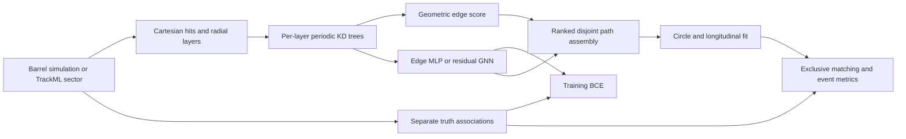

# Architecture

The graph builder receives four measurement columns. Per-layer trees index (cos φ, sin φ). Search the next two radial layers with chord distance ≤0.23; require increasing radius and |Δz| < 2Δr + 3 mm. Keep the eight lowest |Δφ|/0.12 + |z_intercept|/0.05 per target layer. Dense pairwise arrays are unnecessary. Worst-case CPU work can still grow quadratically in a tightly clustered sector. Each source yields ≤16 edges under defaults.

Node inputs are (r/0.32, cos φ, sin φ, z/0.5, layer/7). Edge inputs are (wrapped Δφ/0.12, (Δz/Δr)/2, beam-axis z intercept/0.05, Δr/0.08), lengths in metres. The network standardizes these using training moments. The edge encoder sees both encoded endpoints and the relative measurements. At each message step a node receives the mean incoming edge embedding, then a residual edge update uses both updated endpoints. The zero-step model supplies the MLP control. Native torch index_add handles sparse aggregation. A forward/backward device probe selects CPU on unsupported MPS graph operations.

Assembly visits edges by descending confidence with stable ties. Each node can have one predecessor and one successor. The outward radial ordering precludes cycles. Classical and hybrid assembly require cosine >0.985 for newly completed triplets at either end. This local direction test can reject genuine high-curvature tracks. All methods share candidate windows, exclusive ownership and minimum length. The GNN-only row removes the triplet test; it still uses geometric inputs.

The fast fit uses an SVD solution for a circle passing through the beam axis and a linear fit in transverse arc length for z. The independent robust fitter optimizes the tangential and longitudinal measurement residuals with a soft-L1 loss at the 0.2 mm resolution scale. Both assume outward first intersections. Charge sign is −sign(k B) and pT is |0.299792458 B/k| with known calibrated B. Straight tracks have unbounded pT. Near-straight momentum is poorly conditioned.
